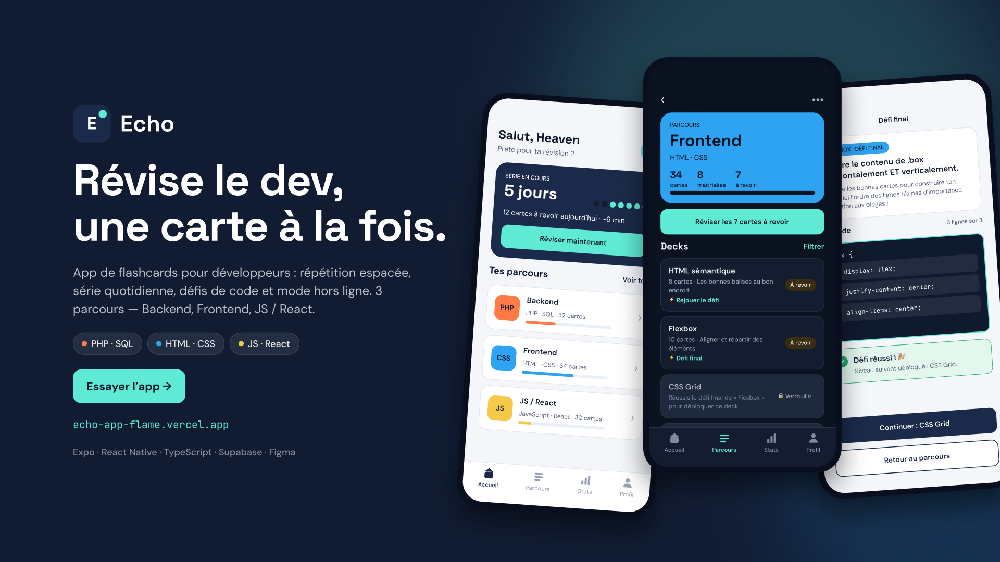

<div align="center">

# Echo

**Learn to code, one card at a time.**

A flashcard app for reviewing web development: PHP, SQL, HTML, CSS, JavaScript and React.

[**Try the app →**](https://echo-app-flame.vercel.app)



[Français](README.md) · **English**

</div>

---

## How it works

- **3 tracks**: Backend (PHP, SQL), Frontend (HTML, CSS) and JS / React
- **Levels** in every track. To unlock the next one, you pass a short quiz
- **Go at your own pace**, on all 3 tracks at the same time
- **Cards to flip**: a question on the front, the answer with a code example on the back

## With or without an account

| | Guest | With an account |
|---|---|---|
| Try every card | ✅ | ✅ |
| Progress saved | ❌ | ✅ |
| Daily streak | ❌ | ✅ |

## Tech stack

| | |
|---|---|
| **Design** | Figma (zoning, wireframes, design system) |
| **Front end** | React Native, Expo, TypeScript |
| **Back end** | Supabase (authentication and database) |
| **Deployment** | PWA exported with Expo, hosted on Vercel |

### Why a PWA?

Echo was designed as a mobile app. Publishing a native app on the stores requires paid developer accounts and a review process. So Echo is exported for the web and deployed as a PWA: the same codebase, available from any browser and installable on a phone like a real app.

## Run it locally

```bash
git clone https://github.com/HEAVENGHOBRIAL/echo-app.git
cd echo-app
npm install
```

Create a `.env.local` file at the root with your Supabase keys:

```
EXPO_PUBLIC_SUPABASE_URL=...
EXPO_PUBLIC_SUPABASE_KEY=...
```

Then start it:

```bash
npx expo start
```

## What's next

Echo is at **V1**. Next steps: more languages and new levels.

---

<div align="center">

Designed and built by **Heaven Ghobrial**, a BUT MMI (Multimedia & Internet) student at IUT du Puy-en-Velay, France.

</div>
